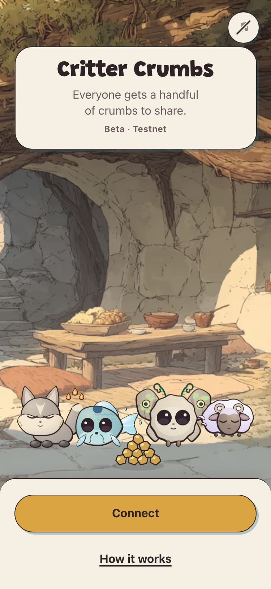
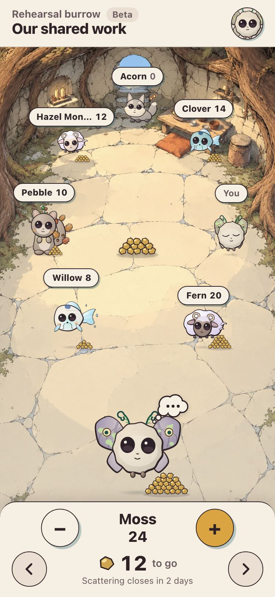
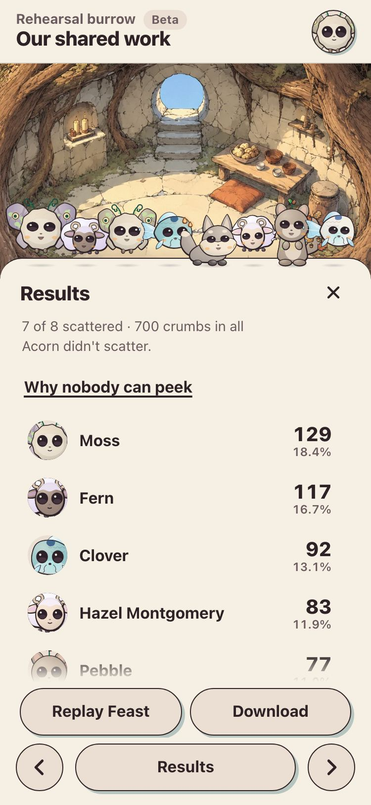

# Critter Crumbs

A private way for a community to share a budget or recognise contributions. Everyone gets the same handful of **crumbs**, allocates them independently, and sees the result when the **feast** opens.

Your group is a **burrow**. The people or budget options receiving crumbs are **critters**: generated characters that grow when fed. What you give is your **scatter**: all your crumbs, shared out as you choose. Tap to give a crumb, hold to pour, or enter an exact number.

<p align="center">
  
  
  
</p>

[Testnet beta](https://www.crittercrumbs.app) · [How it works](https://www.crittercrumbs.app/how-it-works) · [Why nobody can peek](https://www.crittercrumbs.app/how-it-works/why) · [Documentation](docs/README.md) · [Licence and reuse](#licence-and-reuse)

## Why it exists

The first proposed split can anchor a discussion. Visible work can overshadow quiet contributions, and public individual allocations can encourage reciprocal favours. Critter Crumbs gives each member equal allocation power and keeps scatters encrypted until the deadline, so people can decide independently.

The allocation mechanic comes from [Coordinape](https://coordinape.com): everyone gets the same amount to give. The main difference is that nobody sees where anyone's crumbs went until every crumb is in. Critters can also be budget options, not only people.

Two feast types use the same mechanic:

- **People feast:** recognise contributions by giving crumbs to other people.
- **Options feast:** split a budget across options described by the creator.

## How a feast works

1. **Gathering.** Members write what they did, or the creator describes the budget options. Statements stay hidden until scattering opens.
2. **Scattering.** Statements open together. Members read them and privately allocate their crumbs. A complete scatter can be replaced until the deadline; the latest accepted scatter counts.
3. **The feast.** At the deadline, Shutter's keypers release the decryption key. Each device decrypts and computes the same deterministic tally. Results can be exported as CSV.

Everyone gets the same number of crumbs and must allocate all of them. In a people feast, you cannot give crumbs to yourself. Members who do not scatter can still receive; the burrow is told who did not take part. Shares are proportions of the crumbs actually scattered.

## Try it

- **No account needed.** [How it works](https://www.crittercrumbs.app/how-it-works) is five short screens with ten practice crumbs to give and a worked result. [Why nobody can peek](https://www.crittercrumbs.app/how-it-works/why) sets out what the app promises, and the one limit it does not hide.
- **To join a feast**, connect an Ethereum account from a browser extension such as MetaMask. A wallet app's built-in browser on a phone should also work but has not yet been checked on real phones, and WalletConnect is not supported yet. Scattering is a signature, not a transaction, so members pay no gas.
- **To run it locally**, with simulated key release and eight test accounts, see [Run a local rehearsal](#run-a-local-rehearsal).

## Current status

Critter Crumbs is a **testnet beta**, live at [www.crittercrumbs.app](https://www.crittercrumbs.app) since 11 October 2026. It runs on test networks: Shutter on Chiado, Gnosis Chain's testnet, and EAS on Base Sepolia. The [deployment record](docs/build/deployment.md#deployment-record) lists every release.

A solo smoke feast ran on the beta on 29 October 2026, with a [successful registration on Chiado](https://gnosis-chiado.blockscout.com/tx/0xe7cc1334a573592fbbc456ee602c0d2faf42d351b8b273d44c39ab9758536232). Mainnet access has been requested from Shutter ([#17](https://github.com/wefa-labs/critter-crumbs/issues/17), [#18](https://github.com/wefa-labs/critter-crumbs/issues/18)). Next come a rehearsal with the group and the first real feasts: a council of 6–10 people recognising contributions, then splitting a budget. The specifications planned these for September and October 2026.

The app implements burrows and membership, feast setup, statements, private scatters, local tallying, result fingerprints and CSV export. It currently produces an allocation decision; payments are made separately. Results are viewed within the burrow. Hosted public-result recording and visitor results remain integration work; local rehearsal recording uses a fixture.

Mainnet integration, phone connection through WalletConnect, fund-holding contracts, automated payouts and Chinese localization are planned work. Permanent allocation privacy is a research goal.

The [rehearsal run sheet](docs/build/rehearsal.md) and [phone and accessibility checks](docs/reviews/october-qa/phone-checks.md) describe the remaining validation with people and real devices.

## Privacy and verification

Scatters are encrypted in the browser with [Shutter](https://www.shutter.network)'s threshold timelock. Independent keypers on Gnosis Chain hold the key to each feast's deadline between them, so no single keyper can release it. Each scatter is signed as an off-chain [EAS](https://attest.org) (Ethereum Attestation Service) attestation, so it carries the member's signature without a transaction. The server stores ciphertext and serves it back; it never sees an allocation and never computes a result. Published receipts and the set of scatters at close let members check whether their accepted scatter was included. The tally runs independently on each device.

**Privacy after the feast has a limit.** Once the decryption key is released, anyone who can obtain the ciphertexts can decrypt individual scatters. The option to keep individual scatters closed after the feast is enforced by access and display rules. Permanent cryptographic privacy is future work. Participation is visible within the burrow even before the feast.

The app has no analytics or telemetry. The [product requirements](docs/01-prd.md#8-privacy-and-trust) and [technical specification](docs/04-technical-spec.md) describe the trust model and its boundaries.

## Who builds it

Critter Crumbs is developed by **WEFA LLC**. Write to [afo@wefa.world](mailto:afo@wefa.world) with questions or for permissions, and use [GitHub issues](https://github.com/wefa-labs/critter-crumbs/issues) for bugs and proposals.

The four specifications are written for coding agents, with a person reviewing their work. [AGENTS.md](AGENTS.md) holds the rules every agent follows (`CLAUDE.md` links to it), and `.agents/skills/` holds their shared workflows.

## Licence and reuse

Developed by **WEFA LLC**. The core, functional frontend and server software are licensed under [MIT](LICENSE-MIT), with explicit exclusions for the generator and creative assets. WEFA retains copyright in its original work. MIT permits modification, distribution and commercial reuse of the covered software with the required notices.

| Material | Terms |
|---|---|
| Protocol, cryptography integrations, tally, phase rules, schemas, validators, API, database code, functional frontend, tests, tooling and documentation | MIT |
| Critter generator and layout implementations, portrait and mesh artwork implementations, specified drawing data, art, audio recordings and branding | WEFA rights reserved, subject to existing third-party terms |
| Third-party dependencies and fonts | Their existing licences |

[LICENSE](LICENSE) explains the split; [LICENSE-WEFA](LICENSE-WEFA) identifies the reserved material, including copies embedded in builds and prototypes. Audio playback and other functional code remain MIT when they refer to reserved assets. The Grandstander font retains its [SIL Open Font License](packages/app/public/fonts/Grandstander-OFL.txt).

The complete branded build includes reserved modules and assets. Reusing those portions requires separate written permission from WEFA or replacements for the generator, art, audio and branding. Contact [afo@wefa.world](mailto:afo@wefa.world) for permissions. Package-local licence files describe each workspace's scope.

## Review the implementation

| Location | Responsibility |
|---|---|
| [packages/core](packages/core) | Signing, timelock encryption, tally, result verification and API client; also contains the separately reserved generator |
| [packages/shared](packages/shared) | Types, validators, copy and shared constants |
| [packages/api](packages/api) | Server handlers, encrypted storage, membership and lifecycle rules |
| [packages/app](packages/app) | Screens, interaction, portraits, 3D and audio playback |
| [api](api) | Vercel route exports only; the server code is in `packages/api` |
| [db](db) | Database migrations, and the PGlite database used locally and in tests |
| [scripts](scripts) | The local API, seeding, deployment, schema registration and the repository checks |
| [tests](tests) | API tests on PGlite, deployment-script tests, and the browser suites: lifecycle (e2e), screens, captures and the demo film. Package unit tests sit in each package's `test` folder |
| [fixtures](fixtures), [patches](patches) | Sample statements for seeded feasts; small patches to two dependencies |
| [output/pdf](output/pdf) | A project brief from September 2026; its plans and dates are from then |

The four specifications cover [product behaviour](docs/01-prd.md), [design](docs/02-design-system.md), [game feel and simulation](docs/03-game-design.md) and [technical architecture](docs/04-technical-spec.md). [CONTEXT.md](CONTEXT.md) is the glossary; [decisions](docs/decisions.md) and [ADRs](docs/adr) record consequential choices. The [documentation index](docs/README.md) lists everything else in `docs/`.

The stack is Vite, React and TypeScript; React Three Fiber and Koota for the critters; viem, Shutter and EAS for signing and encryption; and Vercel Functions with Neon Postgres for the hosted service.

## Run a local rehearsal

Use **Bun 1.4.2** and **Node 22.22.1**. The setup below runs the complete branded build, subject to the reserved-material permissions above. From the repository root:

```sh
bun install --frozen-lockfile --ignore-scripts
SHUTTER_MODE=mock DEV_ENDPOINTS_ENABLED=1 LOCAL_API_PORT=4300 bun run dev:local
```

In another terminal, seed a feast:

```sh
LOCAL_API_PORT=4300 bun run seed --phase gathering
```

Open the printed feast at `http://127.0.0.1:5173`. The Connect dialog provides eight local rehearsal accounts. These use public test keys; never fund them. Local mock mode uses a local database and simulated key release. Local result recording uses a fixture and sends no real transaction.

[Local core](docs/build/local-core.md) explains fixtures, clock controls and key release. Hosted-service configuration is covered in the [deployment guide](docs/build/deployment.md).

## Validation

```sh
bun run check
bun run build
```

`check` runs lint, typechecking, tests, development-asset and workspace checks, licence and archive verification, and the dependency audit. `build` compiles the workspaces, builds the app and enforces chunk budgets.

Browser lifecycle tests require the running mock app/API and an explicit Chromium installation:

```sh
bun run e2e:install
bun run e2e
```
