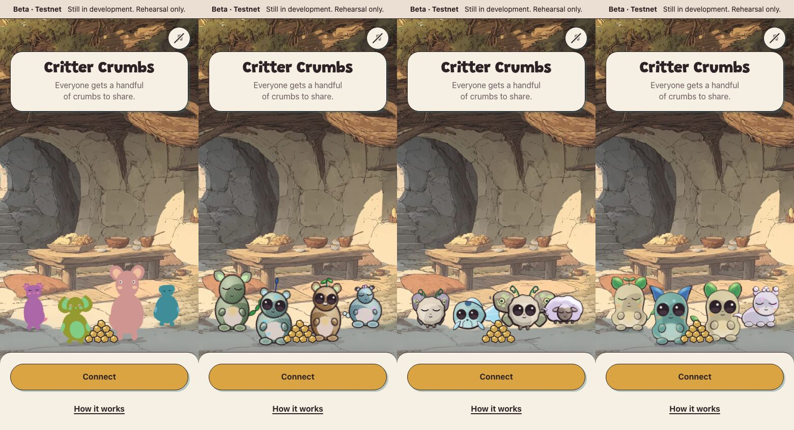
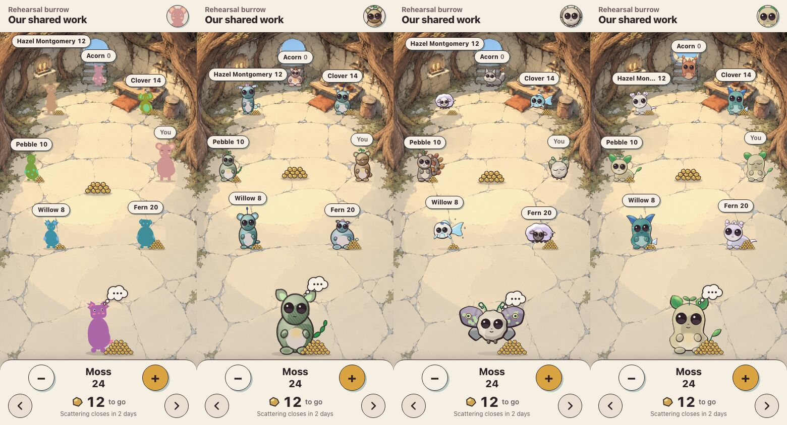
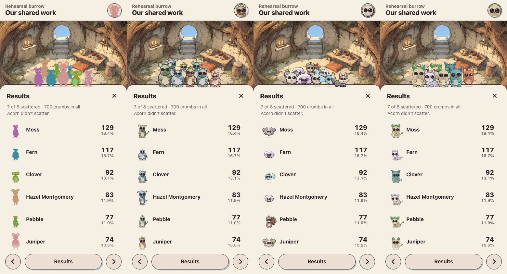
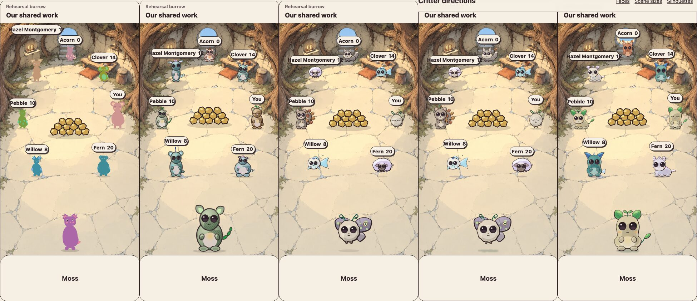
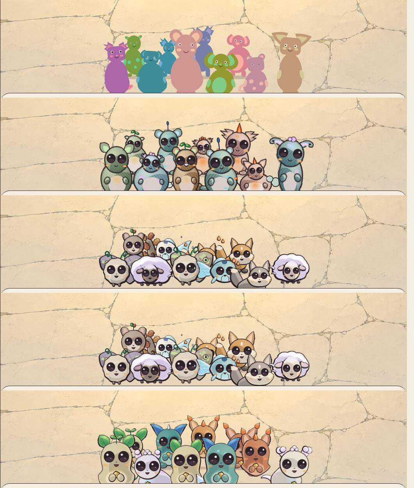
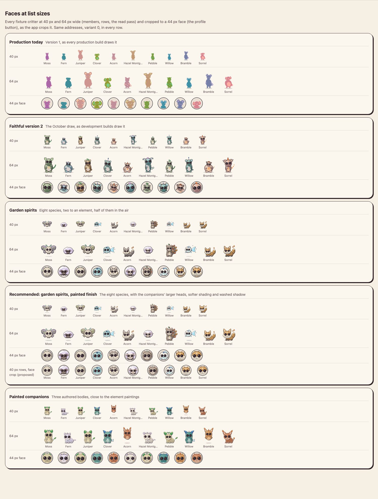
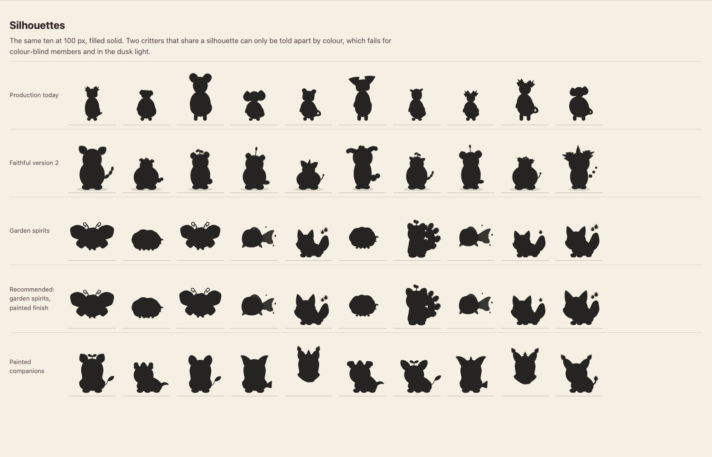
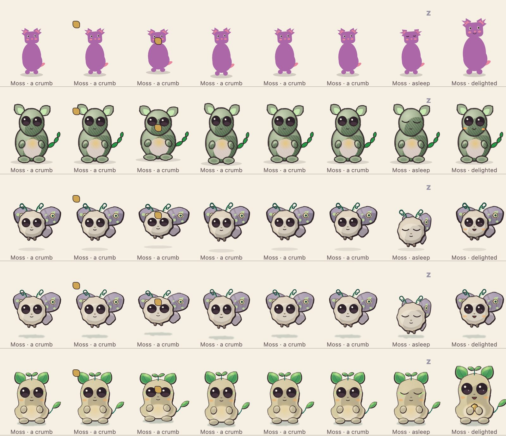

# Critter directions

**Review decision, 16 October:** Afolabi selected painted Garden Spirits, eight species, portraits first, with opt-in migration. The drawings still need refinement and integration review. [Claude's refinement brief](../claude-code-critter-refinement-2026-10-16.md) supersedes the earlier open direction and migration proposals below.

16 October 2026 · Exploration for the visual and sound brief (`../claude-code-visual-brief-2026-10-15.md`, part 1). Nothing in the app, its generator or its fixtures changed; the review page draws everything itself.

## Recommendation

**Selected direction for refinement: Garden spirits, with the painted companions' finish.** Eight species, two to each element, drawn with the companions' larger heads, softer shading and washed shadows. The current prototype has three grounded species and five flying or floating species, including both air species. Finished art, integration and release timing remain for review; migration will be opt-in.

Why, in one line each:

- **It most directly follows the creature research.** The design pass asks for diverse elemental creatures with a spiritual feel, including both flying and grounded creatures (Appendix H). Version 2 has one body for everyone; the companions have three.
- **Its silhouettes differ.** In the silhouette row a moth, a lamb, a koi, a fox and a squirrel cannot be confused. Version 2's ten are ten seated beans with different ears.
- **The companions' finish fixes what the garden spirits lose at list sizes.** Larger heads and softer shading keep faces readable at 40 px. Their shadows and warmth sit closer to the element paintings.
- **Refine the intended family before release.** An interim version 2 release adds another supported appearance and transition to explain. With stored versions and opt-in migration, neither release requires everyone to change their critter.

What it costs, and what is still yours to decide, is under [Version and identity](#version-and-identity) and [Open choices](#open-choices).

If you would rather improve production before the feast, **faithful version 2 reproduces the October appearance in these captures**: the same seeds look like the October mocks in every real screen (below). Shipping it still needs a release/identity decision and performance checks. It has no 3D, and it was measured at 3 to 4 frames a second in WebKit with ten animated critters (memory of 11 October; not re-measured here).

## How to look

Open [`index.html`](index.html) in a browser from this folder (it is one classic script, so it works from the file system). Sections: faces at 40 and 64 px and the 44 px face; whole bodies at the circle's sizes; silhouettes; eight and ten critters in the app's own layouts on the Window plate; awake, asleep, a crumb arriving and delighted; the exact data. **Still** stops the motion; reduced motion stops it too.

To rebuild the page's script after changing a painter, from the repository root:

```bash
mise exec node@22.22.1 -- node docs/explorations/critter-directions/build.mjs
```

## The directions

| | What it is | Where it comes from |
|---|---|---|
| **Production today** | Version 1: flat shapes in a hue drawn from the full circle, small dot eyes, no outline | `packages/app/src/portraits/index.ts`, unchanged |
| **Faithful version 2** | The October draw: the element first, a plum ink line, cel shading with hatching, big dark eyes, one seated body | `packages/app/src/portraits/painter-v2.ts`, unchanged. The mock pages' painter (`../scatter-layouts/lib/kit.js`) is the same drawing line for line. |
| **Garden spirits** | The creature research's eight first species: acorn squirrel and lichen moth (earth), pond turtle and koi kite (water), ember fox and phoenix chick (fire), flying lemur and cloud lamb (air). The element is in the anatomy: a tail that is a spray of oak leaves, a shell of river stones holding a pool, foxfire lanterns, a body of cloud. Fliers hover over their shadow. | `src/garden.ts` (new) |
| **Recommended** | The same eight, with heads a fifth larger, the companions' softer shadow and warm rim, no hatching, and a washed shadow tinted by the element | `src/garden.ts`, `finish: 'painted'` |
| **Painted companions** | Three authored bodies (sitter, floater, lounger) close to the four element paintings: leaf, fin, flame or cloud ears, sprouts and drops, painted spots, a glowing belly, and a crumb held to it once fed | `src/companions.ts` (new) |

The new Garden Spirits, its softer finish, and Painted Companions share one face (`src/face.ts`): big round dark matte eyes with one small highlight, a calm mouth that opens when delighted, peach cheeks. They also share the ink line and light of `src/ink.ts`: plum line `#2E2226` heavier on the shadow side, one light from the upper left, shadows cool and lights warm.

**How the explorations get their numbers.** To show the same critter five ways, the two new painters take their numbers from the version 2 draw of the same address and variant, and keep its element. A shipped direction would get its own draw order and version (see below).

## What the comparison shows

### In the real screens

Same addresses, variant 0, captured from this worktree's app at 390 × 844: production parity (`?critters=1`), the development default (version 2), and the two explorations through a temporary development-only switch (`preview-hook.patch`, applied for the captures and reverted).



Version 1 is the main reason the live app looks unlike the mocks: flat, saturated shapes with dot eyes, sized by their own proportions (Juniper's pink body towers over the table), pasted onto the painting. Version 2 sits in it.





Desktop captures of the same screens: [launcher](images/app-launcher-1440.jpg), [scattering](images/app-scatter-1440.jpg), [results](images/app-results-1440.jpg). The first steps at 390 × 844: [one](images/app-learn1-390.jpg), [two](images/app-learn2-390.jpg), [three](images/app-learn3-390.jpg).

### In the app's own layout, all five

The scattering circle for eight at 390 × 844, placed by `game/layout.ts` on the Window plate raised by `game/plate.ts`, as the app places it:



The results huddle for ten at 1440 × 900:



The garden huddle is the liveliest and the busiest: where wings overlap it turns into a tangle. The companions' huddle is the most legible, everyone holding a crumb. The recommended finish keeps the garden's variety and reads a little calmer.

### Faces, silhouettes and motion



At 40 px the wide species (the moth's wings, the koi's tail, the squirrel's plume) are fitted into the same 120-unit box, so their faces shrink. The recommended block adds a proposed row: 40 px rows drawn as face crops, which keeps every face the same size.



Garden spirits gives the clearest silhouettes, but twins of one species share one: the ten fixtures hold three ember foxes, two moths, two lambs and two koi. Colour and markings must carry those twins. Coats are already drawn per individual (russet, marigold, ash, dusk red for foxes; pearl, river teal, slate, sand for koi), and the other four species of the research would cut the repeats.



Each row: the crumb hops in over 200 ms, then the Game Design bump plays from its landing (1.08 / 0.92, then 0.97 / 1.04 at 90 ms, settled by 260 ms). Then asleep, then delighted. A sleeping flier settles a third of the way to the floor and folds its wings. The companions hold a crumb once they have been fed.

## What the recommendation would change in the app

These are integration notes for Codex once you choose. The workstream boundaries are in `AGENTS.md`.

- **A generator version.** See below. The painter goes beside `painter-v2.ts` behind the same version switch.
- **`PortraitExtent` gains `headX` and `hover`.** Three of the eight species draw their heads off centre (the fox and the koi by 8 units of the 120-unit box, the turtle by 13), and fliers stand above their feet. The header's face crop (`game/styles.ts` `faceCrop`, used in `game/parts.tsx`) centres on `headX` or it cuts the face off. The circle's tags and bubbles already read `top` and `headY`, which include the hover in these drawings.
- **List rows at 40 and 44 px draw a face crop**, not the whole body, for any species wider than tall.
- **Rendering cost.** The prototypes use version 2's technique (live SVG filters for the loose line, grain and soft shadows), which an earlier measurement found too slow to animate in WebKit. Draw each critter once into a few bitmaps (body, head, ears, eyes) and animate those with transforms. The look at rest must not change; compare pixels.
- **Motion.** Breath and blink scale the finished drawing, as the floor critters do today. Fliers add a bob of 3.5 px over 2.6 s. Wings could beat with a separate layer, which needs the bitmap split. Reduced motion and Still critters remove all of it (Game Design §3.5).
- **3D.** None of the new drawings has a mesh. Either the new version renders as portraits only, as version 2 does (D16), or a mesh style is decided first. Simple view is the portrait in both cases.
- **Dark mode.** Not graded here. The critters keep their colours under D26, but the fliers' washed shadows and the glow points should be checked against the dusk wash.

## Version and identity

A proposal for you and Codex. Nothing here is decided, and nothing in code changed. The identity research (`../../research/critter-identity-options-2026-10-15.md`) is the background.

1. **A new version, not a change to an old one.** Version 1 and its fixtures stay frozen (D8), and so does version 2. The proposed new generation recipe needs its own version and independent vectors, as version 1 has (`docs/research/generator-v1-vectors.md`). The explorations' trick of reading version 2's numbers is for this comparison only. Exact draw order and outputs remain part of the later integration review.
2. **Drawing versions become stored identity data.** Codex is preparing explicit generator/renderer versions on profiles and feast appearance snapshots; Technical Spec §3.1 owns that contract. The current browser still uses its build setting. Later integration must render each stored appearance and preserve previous choices when someone opts in; changing one global switch is insufficient.
3. **Existing members: explicit opt-in, chosen 16 October.** Preserve each existing choice and let its owner preview and explicitly adopt the new version. Mixed versions within a burrow are acceptable. The new-version selection allowance and exact consent flow still need review; existing locks and reroll counts are not reset. Codex owns persistence and feast appearance retention.
4. **Timing.** Production remains v1 during refinement. Art integration and release timing require Afolabi's review. No automatic redraw is approved.

## Open choices

- Painted Garden Spirits, eight species, portraits first, and opt-in migration are chosen. Finished art and integration remain pending.
- The exact new-version selection allowance and consent flow.
- Whether the crumb held to the chest once fed (companions) should carry over to the species that have paws (squirrel, fox, lemur).

## Exact data

Seed text is `address:variant:version` with the address lowercased, hashed with cyrb53 into mulberry32 (`packages/core/src/generator`). The table on the review page lists it in full. Every critter below is variant 0.

| Critter | Address | Version 1 draw | Version 2 draw | Garden spirits | Painted companions |
|---|---|---|---|---|---|
| Moss | `0x7E5F4552091A69125d5DfCb7b8C2659029395Bdf` | egg body, tufts ears, hue 329 | earth: leaf ears, no crest, branch tail | Lichen moth | Sitter |
| Fern | `0x2B5AD5c4795c026514f8317c7a215E218DcCD6cF` | egg body, floppy ears, hue 208 | air: cloud ears, no crest, cloudwisp tail | Cloud lamb | Lounger |
| Juniper (the viewer) | `0xF1F6619B38A98d6De0800F1DefC0a6399eB6d30C` | capsule body, round ears, hue 24 | earth: round ears, sapling crest, puff tail | Lichen moth | Sitter |
| Clover | `0x1efF47bc3a10a45D4B230B5d10E37751FE6AA718` | bean body, floppy ears, hue 112 | water: round ears, reed crest, stub tail | Koi kite | Sitter |
| Acorn | `0xd41c057fd1c78805AAC12B0A94a405c0461A6FBb` | bean body, round ears, hue 3 | fire: pointed ears, ember crest, emberwisp tail | Ember fox | Floater |
| Hazel Montgomery | `0xe1AB8145F7E55DC933D51a18c793F901A3A0b276` | egg body, pointed ears, hue 60 | air: fern ears, no crest, cloudwisp tail | Cloud lamb | Lounger |
| Pebble | `0x6813Eb9362372EEF6200f3b1dbC3f819671cBA69` | bean body, long ears, hue 126 | earth: leaf ears, sapling crest, branch tail | Acorn squirrel | Lounger |
| Willow | `0xE57bFE9F44b819898F47BF37E5AF72a0783e1141` | bean body, tufts ears, hue 218 | water: round ears, reed crest, stub tail | Koi kite | Sitter |
| Bramble | `0x000000000000000000000001daa66d2c7ddf743f` | bean body, tufts ears, hue 274 | fire: flame ears, seedpods crest, emberwisp tail | Ember fox | Floater |
| Sorrel | `0x00000000000000000000000d98c475f0f066a9ce` | bean body, floppy ears, hue 11 | fire: flame ears, ember crest, spark tail | Ember fox | Lounger |

The ten are the review gallery's fixture set (`packages/app/src/dev/game-members.ts`). The launcher's four (`app/painted-scene.ts`: Moss, Clover, Juniper, Fern) are among them.

## Files

- `index.html` and `lib/directions.js`: the review page and its built script.
- `src/ink.ts`: the line and light both explorations share. `src/face.ts`: the shared face. `src/garden.ts` and `src/companions.ts`: the two painters. `src/page.ts`: the page. `src/core-shim.ts`: the generator alone, without the rest of `@critter-crumbs/core`.
- `build.mjs`: builds `lib/directions.js`. `tsconfig.json`: maps the workspace packages to their sources for the build.
- `preview-hook.patch`: the temporary, development-only switch (`?direction=garden|companions`) used for the real-screen captures. It is not applied.
- `images/`: the captures above, as JPEG.

## Not verified

- Real phones. Everything here was rendered in Playwright's Chromium at 390 × 844 and 1440 × 900.
- Frame rates of the new painters. They were not measured; their technique is the one already measured as too slow in WebKit.
- Dark mode, the dusk scene and Simple view with the new drawings.
- Option feasts (critters from 32-byte target ids). They use the same draw and were not looked at separately.
- Animation beyond the review page's CSS: the app's own pose system (`portraits/pose.ts`) was not run against the new drawings.
