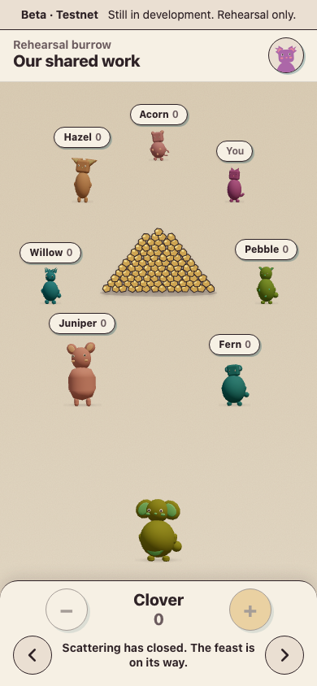
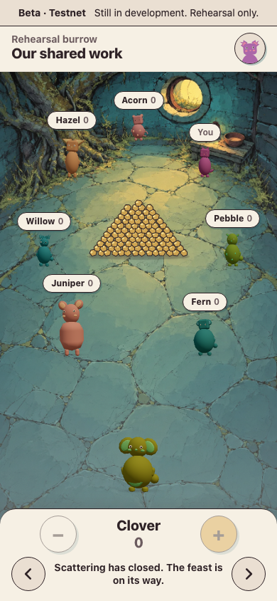
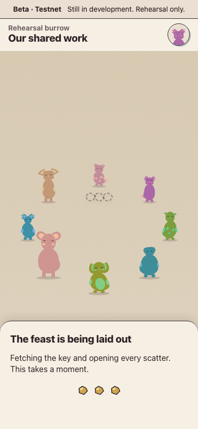
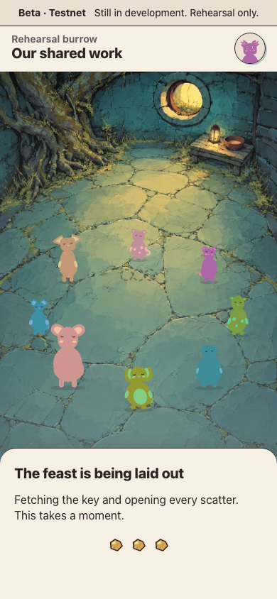

# Dusk painting readiness — 2026-10-12

The proposed change fetches the other plate paintings for the current layout after the current floor has loaded, and retains each native image for the page. It belongs to workstream B. Afolabi approved the extra download on 2026-10-12 and requested merging PR #55 after green CI and deploying to the existing production testnet site.

The scene list comes from `sceneReader`; the existing layout supplies the phone/desktop choice (`DESKTOP_MIN_WIDTH`, 900 px). The selector excludes the current image and crops, and deduplicates paths. An unsuccessful load is forgotten so a later scene can retry. Scene rendering and deadlines keep their existing behavior.

## Download cost

For a member who enters on Window, the additional Dusk body is **218,168 bytes on phone (213.1 KiB)** or **258,122 bytes on desktop (252.1 KiB)**. They pay that cost even if they leave before the deadline. These are file sizes, excluding HTTP headers. Only the active layout’s version is requested.

For a Dusk-first visit, the other painting is Window: 190,726 bytes on phone or 226,942 bytes on desktop. Crossing the desktop breakpoint during the page can fetch the other device’s pair as well. Paintings remain referenced for the page; the browser controls its decoded-image residency.

## Production evidence

The final production bundle had a painted floor in the first captured frame showing each new scene. The three runs per path had these flat-floor counts:

| Transition | Before, runs 1 / 2 / 3 | After, runs 1 / 2 / 3 |
| --- | --- | --- |
| Scatter closes at Dusk | 1 / 1 / 1 | **0 / 0 / 0** |
| Reveal gives way to laid-out sheet | 4 / 2 / 3 | **0 / 0 / 0** |

Before the change, the first painted closing frames arrived 101, 97 and 109 ms after the DOM closed state; the reveal frames arrived 87, 71 and 89 ms after the DOM sheet state. Afterward those first painted frames arrived at 95, 84 and 99 ms for closing, and 61, 61 and 62 ms for the sheet. DOM observation precedes the compositor: in the final reveal run, frames at +7 and +25 ms still show the old reveal; the first frame showing the new sheet at +61 ms already has Dusk. There were no captured bare-page frames on either path.

Dusk transferred once in each final page (218,468 transfer bytes, including headers). Its request began 2 / 2 / 5 ms after the Window response completed in the closing runs, and 1 / 1 / 1 ms afterward in the reveal runs. No page errors were recorded. The full counts and resource summary are in [frame-counts.json](frame-counts.json).

Representative run 1 frames, preserved without editing:

| Closing before (+28 ms) | Closing after (+95 ms) |
| --- | --- |
|  |  |

| Reveal before (+19 ms after DOM sheet) | Reveal after (+61 ms after DOM sheet) |
| --- | --- |
|  |  |

Baseline: unchanged `origin/main` at `56709c8b87f799dd106e9a00ec4b52afa47382a0`, which includes the laid-out/reveal fixes and beta/testnet notice. Each run used a fresh Chromium context at 390 × 844, a production bundle, and an isolated local API with the real-key Shutter fixture. The browser was headless and muted. The server ran through a supervised terminal with Afolabi’s explicit approval. One Playwright job ran per stack.

Frames came from `Page.startScreencast`, with every frame requested. `frames.mjs` reads (30,120) for the dark Dusk floor versus flat tan ground, and (360,700) for the laid-out sheet. Counts describe captured compositor frames, not a real phone’s refresh rate. The key was delayed 2,500 ms on the reveal path to keep the sheet visible.

## Loading versus decoding

The load-only experiment with normal browser caching had **0, 0, 0** flat reveal frames and one Dusk download per fresh page. Explicit `HTMLImageElement.decode()` was therefore unnecessary for this measured Chromium path; the final change keeps native images after their `load` event without an explicit decode call. This is local Chromium evidence, not a claim about every browser or phone.

An early key-delay experiment used `page.route`, which disables HTTP caching ([Playwright documentation](https://playwright.dev/docs/api/class-page#page-route)). Installing that route after warm-up caused a second Dusk download when the laid-out scene mounted. Loading, explicit decoding, and native preload links all still showed gaps under that artificial condition. The final harness delays only the key’s JavaScript fetch from an init script, preserving normal image caching. Those cache-disabled trials are excluded from the final before/after comparison.

## Cache headers

`vercel.json` grants long-lived caching to `/assets/`, not `/scenes/`. That does not address the original first-use gap: a painting first requested at the transition still needs its first download and render. With normal caching and retained native images, Dusk was transferred once within each measured page. Host defaults can affect later page loads and revalidation; this change leaves all headers untouched.

## Regression and checks

The selector test covers phone, desktop, current-image exclusion, deduplication and crops exclusion using the shipped manifest. The two closing e2e paths observe painting requests before opening the game, require phone Dusk before advancing to the deadline, verify Window is requested first, and reject desktop Dusk. Both checks failed before implementation and passed afterward.

- `mise exec node@22.22.1 -- bun run check` passed: lint, typecheck, 77 Vitest files / **589 tests**, tooling and development-asset checks, workspace probe, licences/archive integrity, and vulnerability audit.
- `mise exec node@22.22.1 -- bun run build` passed, including enforced chunk budgets.
- `mise exec node@22.22.1 -- bun run e2e` passed all **29 tests** with one worker (3.7 minutes).
- Both before-deadline request checks were red on the unchanged implementation and green with prefetching; the selector test was likewise red before the helper was added.

Read-only two-axis review of `56709c8…e77cd2f` found **0 actionable Standards findings** and **0 actionable Spec findings**. The measured Window response completed 4, 4 and 1 ms before the Dusk request in the load-only reveal experiment. The approved tradeoff is recorded in `docs/decisions.md` (2026-10-12).

## Reproduce

The ignored `.scratch/reveal-stays/` in the attached worktree retains the harness, before/after bundles, JSONL timing and resource records, and full compositor images. Run from that worktree with the isolated stack supervised:

```sh
mise exec node@22.22.1 -- node .scratch/reveal-stays/measure.mjs before 3 --frames --frames-early --label=baseline-scatter
mise exec node@22.22.1 -- node .scratch/reveal-stays/measure.mjs before 3 --screen=reveal --frames --hold-key=2500 --label=baseline-cached-reveal
mise exec node@22.22.1 -- node .scratch/reveal-stays/measure.mjs after 3 --frames --frames-early --label=final-scatter
mise exec node@22.22.1 -- node .scratch/reveal-stays/measure.mjs after 3 --screen=reveal --frames --hold-key=2500 --label=final-reveal
mise exec node@22.22.1 -- node .scratch/reveal-stays/frames.mjs final-scatter 1 --all
```

The harness is local scratch evidence and is not included in the application bundle. A transition before a warm-up download finishes can still lack the new painting; this change fetches ahead without delaying phase changes.
