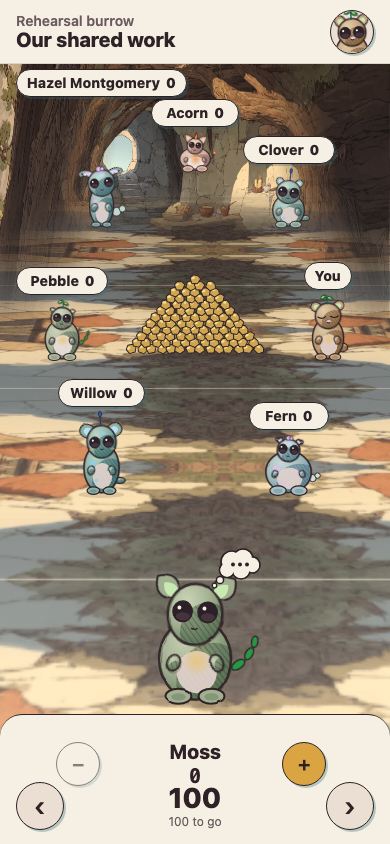
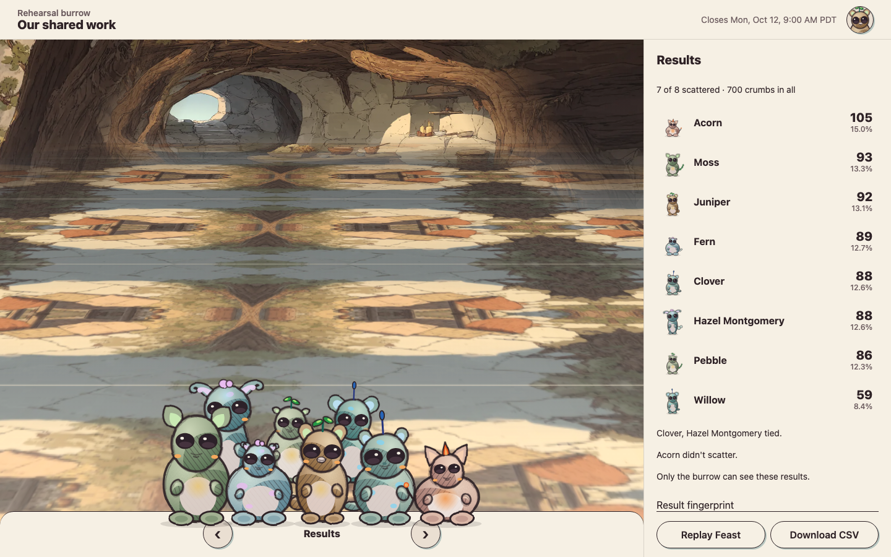

# October game review evidence

The core game adopts the October review through M4. The launcher, connect, first steps, burrows, feast setup, gathering, profile and error notices keep their existing flows and layouts, with the new tokens. Existing notices remain visible over the core scene.

Open `/dev/screens` in development for paired phone/desktop fixtures made from the real game components. `bun run screens:capture` writes the 20 states below to `.scratch/screens/`. `bun run demo:record` records the real local mock lifecycle separately from E2E. Both commands require the running `bun run dev:local` surface. The dev gallery/helper do not ship in production.

[Phone rehearsal](demo/phone.mp4) · [Desktop rehearsal](demo/desktop.mp4) · [Demo beats and recording notes](demo/README.md)

## Captures

The gallery uses the review seed addresses. These captures use eight critters at 390×844 and 1440×900. Layout tests also exercise 4/6/8/10 critters with every focus at 375×812, 430×932, 1280×800, 1440×900 and 1920×1080.

| State | Phone | Desktop |
|---|---|---|
| Statements open | [PNG](screens/reveal-390.png) | [PNG](screens/reveal-1440.png) |
| Scattering | [PNG](screens/scatter-390.png) | [PNG](screens/scatter-1440.png) |
| Reading a statement | [PNG](screens/reading-390.png) | [PNG](screens/reading-1440.png) |
| All crumbs given | [PNG](screens/done-390.png) | [PNG](screens/done-1440.png) |
| Confirm your scatter | [PNG](screens/signing-390.png) | [PNG](screens/signing-1440.png) |
| Saving | [PNG](screens/saving-390.png) | [PNG](screens/saving-1440.png) |
| Saved and toast | [PNG](screens/scattered-390.png) | [PNG](screens/scattered-1440.png) |
| Not signed | [PNG](screens/rejected-390.png) | [PNG](screens/rejected-1440.png) |
| Could not save | [PNG](screens/failed-390.png) | [PNG](screens/failed-1440.png) |
| Scattering closed | [PNG](screens/closed-390.png) | [PNG](screens/closed-1440.png) |
| Feast being laid out | [PNG](screens/waiting-390.png) | [PNG](screens/waiting-1440.png) |
| Key not out yet | [PNG](screens/key-390.png) | [PNG](screens/key-1440.png) |
| Feast sequence | [PNG](screens/feast-390.png) | [PNG](screens/feast-1440.png) |
| Results | [PNG](screens/results-390.png) | [PNG](screens/results-1440.png) |
| Nobody scattered | [PNG](screens/nobody-390.png) | [PNG](screens/nobody-1440.png) |
| One scatterer and tie | [PNG](screens/tie-390.png) | [PNG](screens/tie-1440.png) |
| Who gave what | [PNG](screens/givers-390.png) | [PNG](screens/givers-1440.png) |
| Recording a public result | [PNG](screens/recording-390.png) | [PNG](screens/recording-1440.png) |
| Result recorded | [PNG](screens/recorded-390.png) | [PNG](screens/recorded-1440.png) |
| Public aggregate results | [PNG](screens/public-390.png) | [PNG](screens/public-1440.png) |

## Intentional differences from the artifacts

- The feast preserves PR31/Game Design G3’s fixed target order. Its line says the critters wake and grow one by one; it does not promise ranking order.
- Tag placement chooses vertical candidates jointly and tests the complete heap rectangle. The desktop thought bubble clears adjacent tags. This meets the measured section 21 overlap limits without shifting tags away from their critters.
- The real game preserves the API’s frozen participant order; the gallery uses the review’s decorative order.
- Member results retain their verification details. The phone list scrolls while Replay Feast and Download stay reachable.
- Nobody-scattered keeps the circle and a compact results dock. It does not create a celebratory huddle.
- The supplied paintings currently reconstruct the floor from the recorded crops. A new floor-first plate needs only an image and scene-manifest entry.
- The silent demo briefly holds the real key request for the waiting beat, then resumes its normal response after the explicit dev release. Mock keys otherwise open automatically at closing time.

## Validation

The final validation record is in `validation.md`. No dependency was added. Production uses the frozen v1 generator/painter and retains its lazy mesh path; development and these demos use portrait-only v2.

## Feedback still needed

Afolabi chooses when v2 ships (DQ5), whether it gains a mesh, and the 3D render style. New creatures and painted floor-first plates can arrive through their generator/painter and scene registry seams. Feedback on the eight out-of-scope screens remains for the next design pass.
