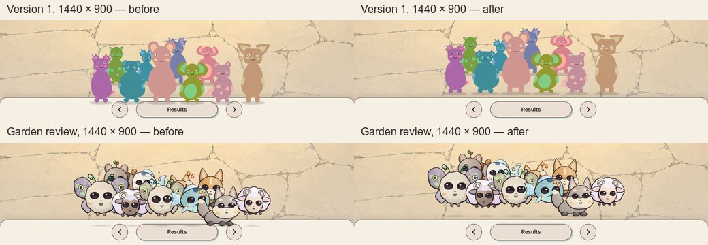

# Results huddle on the desktop dock

Prepared by Claude on 16 October 2026 on `claude/results-huddle-clearance`, stacked on `codex/shared-shell` (PR #56). It changes production layout on desktop, so it is Afolabi's to confirm.

## What was wrong

On desktop the results fold the dock to its 74 px bar (Previous, Results, Next), and the fed critters huddle on its top edge (`huddleAt` in the scatter-layouts review page; Design System D24). The front row stood a tenth of its size into the bar and the back row 0.26 of it above, the same rule as on the phone. On the phone that sinks the feet into the tall results sheet's rounded top, clear of every control. On desktop the bar's buttons start 12 px below its edge, so the huddle covered them:

- A press 3 px inside the top of Previous, Results or Next landed on a critter's portrait or its shadow. This happened in every critter version at both desktop sizes measured, even where no drawn pixel touched a button, because each portrait's box reaches 10 of its 150 units below the feet.
- Drawn bodies reached 11–29 px into the bar and shadows up to 26 px. Their outlines overlapped the buttons by up to 571 px² for version 1, 1,507 px² for version 2 and 384 px² for the Garden Spirits review art.

## The change

Desktop only, in `layoutGame` (`packages/app/src/game/layout.ts`): the huddle now stands on the bar instead of in it. Each front-row portrait's box ends at the bar's top edge, so the feet, the shadow and the margin under them all stay on the floor. The back row keeps its place, 0.36 of the front size above the front row. Sizes, spacing, order, facing and depth are unchanged. The phone is unchanged too: its front row still stands a tenth of its size into the results' rounded top, which covers nothing there.

## Measurements

Distances are from the bar's top edge in CSS pixels; positive is below the edge. Ten critters, with eight in brackets.

| Critters | Viewport | Lowest drawn point, before → after | Lowest shadow, before → after | Buttons covered, before → after |
|---|---|---|---|---|
| Version 1 | 1440 × 900 | +15.4 (+17.5) → −12.8 (−14.5) | +21.8 (+24.7) → −6.4 (−7.3) | all three → none |
| Version 1 | 1280 × 720 | +11.5 (+12.8) → −9.5 (−11.1) | +16.2 (+18.2) → −4.8 (−5.7) | all three → none |
| Version 2 (development) | 1440 × 900 | +25.9 (+28.9) → −2.2 (−3.1) | drawn inside the body | all three → none |
| Version 2 (development) | 1280 × 720 | +19.3 (+21.3) → −1.7 (−2.6) | drawn inside the body | all three → none |
| Garden Spirits review | 1440 × 900 | +17.6 (+20.0) → −10.6 (−12.0) | +23.2 (+26.3) → −5.0 (−5.7) | all three → none |
| Garden Spirits review | 1280 × 720 | +13.1 (+14.7) → −7.9 (−9.2) | +17.3 (+19.4) → −3.7 (−4.5) | all three → none |

On the phone (390 × 844 and 320 × 568) every figure is unchanged: the front row's feet stand 5.6–10.7 px into the results' top, as designed, and no control is covered. The full records are [measurements-before.json](measurements-before.json) and [measurements-after.json](measurements-after.json).

## Evidence

- Desktop, before and after, for each critter version: [version 1 at 1440 × 900](images/before-v1-1440x900.jpg) and [after](images/after-v1-1440x900.jpg); [1280 × 720](images/before-v1-1280x720.jpg) and [after](images/after-v1-1280x720.jpg). Version 2 and the review art use the same names with `v2` and `garden`.
- Phone, unchanged: [390 × 844](images/phone-garden-390x844.jpg) and [320 × 568](images/phone-garden-320x568.jpg), with the review art. The before and after captures were byte-identical, so one of each is kept.

All captures use the development fixtures through the real game components, `/dev/screens?capture&state=results&count=10&scene=window`, with `?critters=1` for version 1, no query for version 2 and `?critters=garden` for the review art. They were taken in headless Chromium 151 (Playwright 1.62.1) at a device pixel ratio of 1, with reduced motion so the huddle is at rest. The playing huddle only lifts critters, so motion cannot bring them back onto the bar. The harness is local and not part of the change.

## Checks

- A new test in `packages/app/test/game-layout.test.ts` requires every desktop results portrait to end at or above the bar at 1280 × 720, 1280 × 800, 1440 × 900 and 1920 × 1080 with 4 to 10 critters, with every head inside the floor, and keeps the phone's front row on the results' edge. It failed before the change (a front portrait reached 24 px into the bar at 1280 × 720) and passes after.
- `bun run check` passed as one command: lint, typecheck, 602 tests in 81 files, 21 tooling tests, development assets, the workspace probe, licences and the audit.
- `bun run build` passed: shell 116,437 / 120,000 gzip bytes, Three 198,469 / 250,000. The review build (`VITE_GARDEN_REVIEW=true`) passed at 116,870.

Not checked: Safari/WebKit and physical devices.
