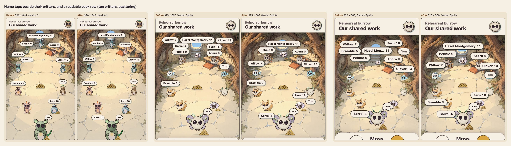
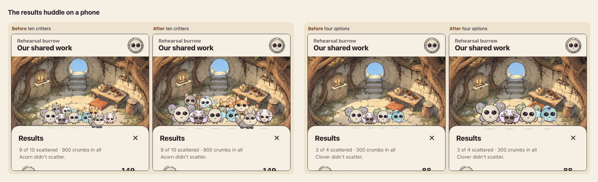
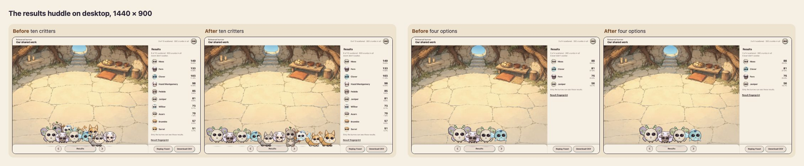
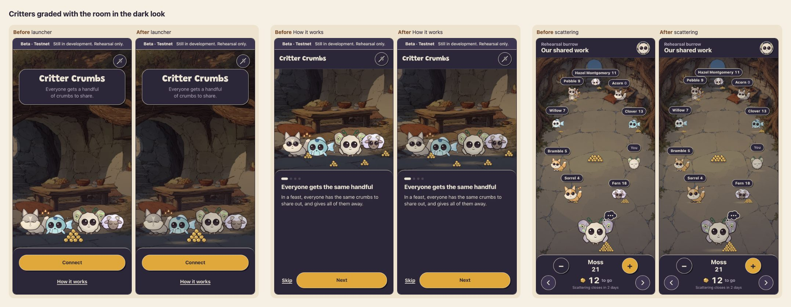
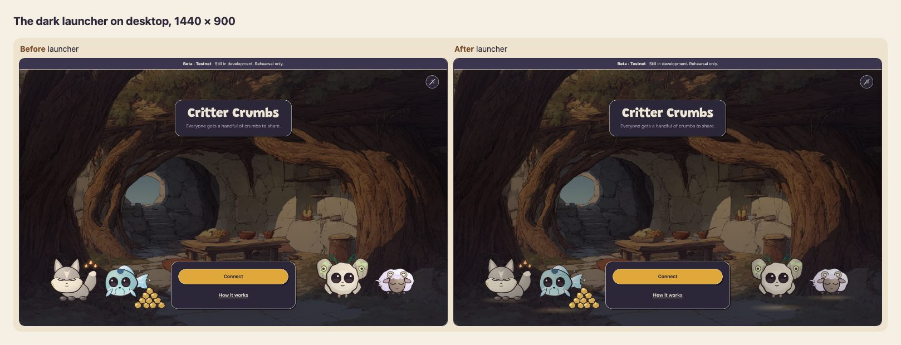

# Visual polish batch, 16 October 2026

This batch addresses four items from the Garden Spirits polish list that a recording would show. Each is one commit on `claude/visual-polish`, on top of `codex/shared-shell` (#56):

| Commit | Change |
|---|---|
| `27565be` | A phone's back row never draws narrower than a 56 px stage. |
| `715381a` | Each name tag stays beside the critter it names. |
| `91b9209` | The results huddle shows each critter as the feast grew it. |
| `7879b26` | The dark look grades critters with the room and stands each in a pool of lamplight. |

The before and after captures come from the same local stack and the same fixture states, with the same critters and the same results. `/dev/screens` gives the game states. Captures use reduced motion so frames are comparable, and Garden Spirits (`?critters=garden`) unless a caption says version 2.

## Name tags and the back row

The tag solver used to move a tag straight up the room until it touched no other critter. On short phones, and on 1280 px desktops with ten critters, tags stacked near the top of the scene, far from the critters they name (QA lifecycle-03). The solver now searches near each critter first and widens only as far as it must:

1. Centred above the head or under the feet, within one tag height.
2. The same, within one and a half.
3. Nudged sideways or beside the body.

A tag may now sit over part of a neighbour rather than drift away. The old wide search remains for a tag that still has no room. The heap, the thought bubble, the piles and the dock stay clear, as before.

| Phone, ten critters | Furthest tag from its critter | Smallest back-row stage |
|---|---|---|
| 390 × 844, version 2 | 202 → 4 px | 53 → 56 px |
| 375 × 667, Garden Spirits | 200 → 4 px | 45 → 56 px |
| 320 × 568, Garden Spirits | 173 → 5 px | 36 → 56 px |
| 375 × 667, eight Garden Spirits | 112 → 20 px | 53 → 56 px |

These figures are measured in the captured pages. Across the test matrix, tags were up to 256 px away. Every tag now stays within one and a half tag heights of its own critter, for eight and ten critters, at every focus, in both drawing versions, on three phones and two desktops. Layout time, measured after a warm-up on this Mac: every size now has a median under 0.6 ms, with one outlier of 15.6 ms (ten critters, 320 × 568). The old solver, given the larger back row, had medians up to 1.8 ms and outliers up to 92 ms. These are single-run timings on a busy machine.

## The results huddle

The huddle spaced every critter by one fixed step, about half a drawing. The feast's growth (Game Design §3.4, up to 1.35 times for the critters that received most) disappeared into a cluster, and the back row hid behind the front.

Each critter is now spaced by the width the feast grew it to, and neighbours overlap by no more than 18% of their width. The group stands in one row whenever everyone fits at full size, as all ten do on desktop and up to eight on a phone. Otherwise the back row stands far enough back that its faces show. On a phone, a small group grows into the room it has, up to 1.3 times.

The burrow's own order is kept; the huddle is never ranked (Game Design G3: the results list carries the ranking). Growth stays the spec's compressed range, so an even split still looks even, as the four-option fixture shows.

## Dark grading

The dark look dims each painting to 60% under a wash, but critters stayed lit as by day: cream bodies glowed against the dim room, and their plum contact shadows vanished on the dark floor.

Two tokens now grade them. `critter-filter` sets brightness .84 and saturation .9 on every critter standing in a painted room: the launcher, How it works, the first meeting, the game's portraits and the 3D canvas. `critter-light` puts a small warm pool of lamplight under each critter's feet.

Faces in the interface, such as the profile button, are left alone. The light look sets both tokens to `none`; [this sheet](images/light-unchanged.jpg) shows the light launcher unchanged, and version 2 critters taking the dark grade. This integrates the night-grade proposal in `docs/explorations/scene-proportions`.

## Calls for Afolabi

- **Tag placement.** On a crowded phone a tag may now sit over part of a neighbouring critter, and may be nudged off-centre when a pile or the bubble takes its centred spot. The review page always centred tags; the old centred-tag test now allows a tag to shift beside its critter instead.
- **One-row huddle.** The review page always used two rows for more than five critters. One row shows everyone whole, but it is a change to that design.
- **Dark grade strength.** The grade is deliberately subtle: .84 brightness, and a pool at 30% opacity at its centre. It could go further.

## Verification

- Unit tests:
  - `circle-legibility.test.ts`: back row at least 56 px.
  - `name-tags.test.ts`: every tag beside its critter and clear of every other tag.
  - `results-huddle.test.ts`: no neighbour hidden, order kept, inside the scene, and a small phone huddle at least 84 px.
- Each new test failed before its change. The other app and shared tests pass, as do the token check and the dark-token contrast tests.
- Captures: 19 before and 19 after, with no page errors.
- Not verified:
  - Safari/WebKit, physical phones and screen readers.
  - The 3D canvas under the dark grade: the fixture draws portraits, and headless Chromium here drew no 3D. Version 1 portraits were checked in the browser pane in dark mode.
